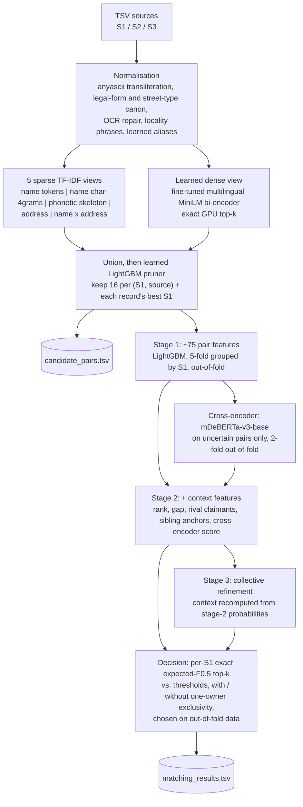

<div align="center">

# Business Entity Resolution — Amazon ML Challenge 2026

### Team **Expecto Patronum**

**🏆 Rank 203 of 32,000+ participating teams  ·  Leaderboard score 0.988365 (macro F0.5)**

*Ten million noisy records, three sources, several scripts, one unseen country — linked with a filter → verify → decide pipeline built only from the provided training data.*


</div>

---

## Table of contents

1. [Result at a glance](#1-result-at-a-glance)
2. [The problem](#2-the-problem)
3. [What the data taught us](#3-what-the-data-taught-us)
4. [Solution architecture](#4-solution-architecture)
5. [Stage-by-stage deep dive](#5-stage-by-stage-deep-dive)
6. [How we climbed: 0.967 → 0.985 → 0.988](#6-how-we-climbed-0967--0985--0988)
7. [Challenge rules and how we comply](#7-challenge-rules-and-how-we-comply)
8. [Reproducing the results](#8-reproducing-the-results)
9. [Repository map](#9-repository-map)
10. [Integrity, caveats and honest limits](#10-integrity-caveats-and-honest-limits)
11. [Team](#11-team)

---

## 1. Result at a glance

| | |
| --- | --- |
| **Competition** | Amazon ML Challenge 2026 — *Business Entity Resolution* |
| **Final rank** | **203rd out of 32,000+ teams** |
| **Leaderboard score** | **0.988365** macro F0.5 |
| **Team** | Expecto Patronum |
| **Metric** | F0.5 per Source-1 entity, macro-averaged (precision weighted 2× recall; singletons score 1.0 only for an empty prediction) |
| **Scale** | 1.73M Source-1 entities, 4.89M Source-2 and 5.08M Source-3 test records |
| **Training data** | 2.21M / 5.03M / 5.29M records (US + India); the test set adds **France**, never seen in training |
| **Learned from** | `dataset/train` only. No external data, APIs, registries or geocoders |
| **Neural models** | `microsoft/mdeberta-v3-base` (MIT, 278M) and `paraphrase-multilingual-MiniLM-L12-v2` (Apache-2.0, 118M) — far below the 8B ceiling |

**Leaderboard trajectory of our own submissions**

| Pipeline | Leaderboard macro F0.5 |
| --- | --- |
| 1 — first end-to-end pipeline | 0.967 |
| 2 — two-stage GBDT + cross-encoder + expected-F0.5 decoding | 0.985196 |
| **Final — + learned dense blocking view, wider sparse recall, stage-3 refinement (kept only if it wins out-of-fold), retuned decision rule** | **0.988365** |

Placing in the top ≈0.6% of 32,000+ teams on a problem with a 1.7M-entity test set, a precision-weighted metric and an unseen country is the outcome of one idea applied consistently: **entity resolution is a relational problem, so every stage should see the competition, not just the pair.**

---

## 2. The problem

Three independent sources describe the same real-world businesses with no shared identifier. Fields are `entity_id`, `business_name`, `business_address`, `country`.

* **Source 1 (S1)** is the clean, de-duplicated reference.
* **Sources 2 and 3** are noisy views of businesses that may or may not exist in S1.
* For **every** S1 entity, output the S2/S3 records that are the same business — possibly none.

Two TSVs are produced:

| File | Purpose | Scored? |
| --- | --- | --- |
| `output/matching_results.tsv` | final matches per S1 entity | **yes** |
| `output/candidate_pairs.tsv` | the exact candidate set the final model scored (matches ⊆ candidates) | no — audited for blocking quality |

Constraints that shaped the engineering: a precision-heavy F0.5, singletons that must be predicted empty, a country (France) absent from training, MIT/Apache-2.0 models ≤ 8B parameters, and a hard ban on external lookups.

---

## 3. What the data taught us

All measurements are on the **training** data (see [`docs/CONTEXT.md`](docs/CONTEXT.md) for the full write-up).

**Label structure**

* 5.58% of S1 entities are singletons; most others have 2–5 matches (mean ≈ 3.5; at most 5 from S2, 6 from S3).
* Every S2/S3 record belongs to **at most one** S1 entity — this licenses a one-owner exclusivity constraint.
* ≈27% of S2/S3 records match no S1 entity at all: they are pure distractors.
* Matched pairs always share the same `country` label, so blocking runs inside each country.

**Signal coverage in true pairs** (≈30k sampled pairs)

| Evidence shared by a true pair | Share |
| --- | --- |
| a name token | 85% |
| an address number | 82% |
| an address word | 94% |
| a name token **or** a number | 97.8% |
| a name token **or** an address word | **99.9%** |

No single blocking key is enough; several complementary views are needed.

**Noise catalogue** — token shuffles, moved/dropped legal forms, appended fillers (`Center`, `Services`), honorifics (`Shri`, `M/s`), punctuation debris, OCR digit swaps (`H0mes`, `5ALINA`), injected accents (`Léarning`), domain-style names (`redcafe.com`), DBA names, rotated address components, state code ↔ name ↔ native script (`TX`/`Texas`, `TG`/`Telangana`/`తెలంగాణ`), house-number variants (`5-402`, `D/402`, `##308`), off-by-one numbers, wrong ordinals (`89nd`). Roughly 8–10% of S2/S3 rows contain **Indic script**, often a phonetic transliteration of the English S1 name (`ఇండో పవర్ ఎల్‌ఎల్‌పీ` = *Indo Power LLP*).

**Why precision is hard** — identical normalised names were non-matches ≈25× more often than matches for generic names (*Summit Inc*, *Horizon*, *Atlas*); unrelated businesses share exact addresses; and near-duplicate siblings (`Baverex LLC 3103 Poplar Pl` vs `Baverex Ltd 3107 Poplar Pl`) are labelled **not** a match. Name and address must be judged **jointly and in context**.

---

## 4. Solution architecture



The design follows the classic **filter → verify** pattern, but each part is tuned to the failure modes the data actually shows.

---

## 5. Stage-by-stage deep dive

### 5.1 Normalisation — make noise look alike before comparing

Implemented in [`normalize.py`](code/business_entity_resolution/src/ber/normalize.py) and [`aliases.py`](code/business_entity_resolution/src/ber/aliases.py).

* **Any script → Latin** via `anyascii`, NFKC, lower-casing; null tokens (`null`, `<NULL>`), ID noise, `m/s` and punctuation debris removed; OCR digit→letter repair inside words.
* **Canonical forms** for legal suffixes (English, Indian and French: *pvt, ltd, llc, inc, sarl, sas, sci…*) and street types (*Rd/Road, St/Street/Saint, Bd/Boulevard, rue…*); ordinal suffixes stripped, leading zeros removed, PO boxes separated.
* **Locality phrase joining** (`uttar pradesh → uttar_pradesh`) mined *without labels* from the S1 records of the corpus being processed.
* **Learned aliases** — token co-occurrence in training true pairs, keeping the S1 form as canonical (`texas→tx`, `up→uttar_pradesh`, `praivet→pvt`, `sophtveyr→software`) behind a plausibility filter that rejected artefacts such as `mr→ltd`.
* **Noise tokens learned from insertion rates** (`center`, `services`…).
* **Transliteration-aware phonetic skeleton** (`ph→f`, `bh→v`, voicing merged, vowels dropped). Double Metaphone is English-centric, whereas this maps `teknalaji` and `technology` to the same skeleton, which is what bridges Indic-script names back to their English originals.

### 5.2 Blocking — a recall ceiling you can trust

Blocking sets the upper bound on the score, so it is built from **complementary views** whose union covers the failure modes of each:

| View | Catches |
| --- | --- |
| name tokens | shuffled / filler-padded names |
| name char-4-grams | typos, OCR noise |
| phonetic skeleton | transliterated and Indic-script names |
| address words + numbers + number×word | rotated components, partial addresses |
| name × address conjunctions | specific keys that survive when every single token is common |
| **learned dense bi-encoder** | records whose every name token is too common for the sparse views |

* One TF-IDF space per **(country, target source)** block with IDF computed *on that block*, so the procedure adapts to any country label, France included.
* Forward top-15 per S1 entity plus **reverse top-5** per S2/S3 record (protects records whose true owner is crowded out by look-alikes), using parallel chunked sparse matrix products.
* **Dense view** — `paraphrase-multilingual-MiniLM-L12-v2` (Apache-2.0, 118M) fine-tuned as a siamese encoder on `name | address` with a symmetric in-batch-negative InfoNCE loss, country-homogeneous batches of 512 (hard negatives; same-entity records masked), exact GPU cosine top-30 forward and top-10 reverse. It is trained on a **separate 15% slice** of entities that no other model fits on, so its cosine is an honest feature rather than a leak.
* **Learned pruning** — a LightGBM ranker over the view cosines and retrieval counts keeps 16 candidates per (S1, source) plus each record's best S1. Its output is exactly what the matcher scores and what is written to `candidate_pairs.tsv`.

> **The scale lesson.** On a 20k-entity training slice the sparse blocking reached 99.9% candidate recall. On the *full* training set, with ≈1M entities per country block, absolute document-frequency caps strip most of a generic name and a fixed top-k is crowded out — hold-out candidate recall fell to **98.0%**. That single measurement redirected our effort to wider recall and the dense view.

### 5.3 Stage 1 — pairwise LightGBM (~75 features)

[`features.py`](code/business_entity_resolution/src/ber/features.py), [`models.py`](code/business_entity_resolution/src/ber/models.py).

* **Name**: Levenshtein/indel ratios, token-set / sort / partial ratios on full and core names, Jaro-Winkler, prefix similarity, skeleton ratio, DBA alternative name, legal-form agreement/conflict, script/domain flags, and **genericness** (corpus frequency of the exact core name, min/max token DF).
* **Address**: ratios on full address and words, street part with localities removed, and a rich **house-number family** (intersection, Jaccard, first-number equality, best Levenshtein between numbers, log difference, ≥3-digit overlap), locality intersection / conflict / subset against a vocabulary mined from S1, empty-address and PO-box flags.
* **Blocking / group**: six view cosines, dense cosine, pruner score, retrieval counts, ranks and gaps within the S1 entity and within the S2/S3 record, claimant counts.
* LightGBM, 255 leaves, learning rate 0.05, **5-fold cross-validation grouped by S1 entity** so no entity leaks across folds; out-of-fold predictions feed everything downstream.

### 5.4 Cross-encoder on the uncertain band

`microsoft/mdeberta-v3-base` (MIT, 278M) — chosen because its multilingual tokenizer natively covers Devanagari, Telugu, Tamil, Bengali… and French accents. It is fine-tuned on `name | address` pairs (128 tokens) and re-scores only pairs with stage-1 probability in **[0.01, 0.99]**, in a **2-fold-by-entity** scheme so its scores are also out-of-fold. Spending transformer compute only where the GBDT is unsure makes a cross-encoder affordable at tens of millions of candidate pairs.

### 5.5 Stage 2 and 3 — relational / collective context

The strongest evidence in this dataset is not in the pair; it is in the neighbourhood.

* **Rank, gap, sum and confident-count** of stage-1 probability within the S1 entity and within (S1, source).
* **Rival claimants** — rank, gap and second-best claimant among all S1 entities competing for the same record.
* **Sibling-anchor agreement** — name/address similarity of the record to the entity's most probable *other* matches, weighted by their probability ("does this record agree with the records I already trust?").
* The cross-encoder score.

Stage 3 recomputes this context from **stage-2** probabilities (which already include the cross-encoder) and adds the margin over the strongest rival — stacked collective classification. The decision step keeps stage 3 only if it beats stage 2 on out-of-fold data.

### 5.6 Decision — optimise the metric, not a proxy

For one entity with independent match probabilities, the optimal prediction is always a top-k prefix and its **exact expected F0.5** has a closed form via Poisson-binomial distributions:

```
E[F | k]  = Σ_{a,b} P(TP = a | top-k) · P(FN = b | rest) · (1+β²)·a / (β²(a+b) + k)
E[F | 0]  = P(no true match at all)          ← protects singletons
```

For each S1 entity we pick `k* = argmax_k E[F|k]` after a temperature calibration fitted on out-of-fold data. A single global threshold cannot do this: macro F0.5 with singletons rewards *abstaining* when the evidence is weak. The decision grid (12 temperatures and 34 thresholds, each with and without one-owner exclusivity) is searched on out-of-fold predictions and then confirmed **once** on the untouched hold-out. A final notebook step (cell 17.7b) re-tunes the rule on the training OOF from the stored checkpoints and rewrites the output only if the new rule wins on **both** OOF and hold-out.

### 5.7 Engineering for ten million records on one instance

* Resumable **checkpointing** at block / 2M-row feature part / model fold / cross-encoder-half granularity, mirrored to S3, hash-keyed on data + settings + upstream steps — resumed runs are bit-identical.
* Stage features live on disk as float32 parts and stream into LightGBM (`lgb.Sequence`); text frames are released while it trains.
* GBDTs are *fitted* on a configurable subset while every other candidate is still scored as a competitor, keeping relational features distributed exactly as on the test set.
* **15% of S1 entities are held out before anything is learned** (aliases, pruner, dense encoder, GBDTs, cross-encoder and decision rule are all fitted without them).

---

## 6. How we climbed: 0.967 → 0.985 → 0.988

The recorded diagnostics of the second pipeline show where the remaining points were:

| Measurement (second pipeline, training hold-out) | Value |
| --- | --- |
| Union candidate recall (sparse top-10 / top-3) | 0.98111 |
| Candidate recall after pruning (12 kept) | 0.97956 |
| Hold-out macro F0.5 | **0.98843** |
| Oracle macro F0.5 on those candidates (perfect matcher) | 0.99350 |
| Leaderboard | 0.985 |

Reading it: the oracle ceiling of **0.9935** means blocking alone cost ≈0.65 points, and the matcher cost a further ≈0.5 points. Both were attacked:

1. **Recall at scale** — wider forward/reverse sparse top-k (15 / 5), a learned dense view with no document-frequency cap, and 16 kept candidates per source. This raises the ceiling itself.
2. **Context** — a stage-3 collective refinement so the model can decide *which of several look-alike entities owns a record*, adopted only if it wins on out-of-fold data.
3. **Decision** — expected-F0.5 decoding with calibration, stage selection and exclusivity chosen on OOF, then re-tuned on the stored checkpoints (cell 17.7b).

The same diagnostics showed a consistent **hold-out → leaderboard gap of about 0.003**, which we attribute to the test corpus having its own size, look-alike density and a new country; cell 15.2 of the notebook measures corpus-size sensitivity on training-derived corpora.

Common remaining error modes: sibling businesses (same name, different house number or legal form), a different business in the same building with an Indic-script name, generic names with an empty S2/S3 address (deliberately left out by the precision-weighted decision), and unrelated brand names where the address is also partial.

---

## 7. Challenge rules and how we comply

| Rule | How it is met |
| --- | --- |
| Model licence MIT/Apache-2.0, ≤ 8B parameters | mDeBERTa-v3-base (MIT, 278M), multilingual MiniLM-L12 (Apache-2.0, 118M); LightGBM (MIT), scikit-learn (BSD), RapidFuzz (MIT), anyascii (ISC) |
| No external data / APIs / geocoders | Only generic abbreviation lists in `normalize.py` (Rd→road, Pvt→private, SARL/SAS…). Every learned artefact comes from `dataset/train` |
| Learn from training data only | The test split is touched only by `predict`; IDF, DF and locality statistics are computed label-free on the corpus being processed |
| France is unseen | No country one-hot, filter or hard-coding; all features are country-agnostic similarities; blocking and IDF are per country label; French legal forms and street types are generic |
| Valid output | One row per S1 entity, no duplicates, S2-/S3- IDs only, matches ⊆ candidates; checked with the official `validate_submission.py` |
| Honest validation | 15% S1 hold-out decided before learning anything; folds grouped by S1 entity |

---

## 8. Reproducing the results

Python 3.11+, GPU optional (the dense view and cross-encoder are skipped without one).

```bash
cd code/business_entity_resolution
pip install -r requirements.txt

# (a) train + validate — uses ONLY dataset/train; writes work/artifacts/metrics.json
python src/run.py train   --data-dir <dataset> --work-dir work

# (b) optional: refit on 100% of training entities
python src/run.py train   --data-dir <dataset> --work-dir work_full --holdout-frac 0

# (c) inference -> output/matching_results.tsv + output/candidate_pairs.tsv
python src/run.py predict --data-dir <dataset> --split test --work-dir work_full --out-dir output

# (d) official format check (from the challenge's student_resource/ folder)
python utils/validate_submission.py --matching output/matching_results.tsv \
       --candidate output/candidate_pairs.tsv --test-dir dataset/test

# (e) build <team>_submission.zip
python src/run.py package --out-dir output --team "Expecto Patronum" --dest .
```

Flags: `--no-cross-encoder`, `--no-dense` (both together give a pure-CPU pipeline), `--holdout-frac`, `--max-train-s1`, `--n-jobs`. All other hyper-parameters live in [`config.py`](code/business_entity_resolution/src/ber/config.py) and are saved with every run.

**Our actual run** used the step-by-step notebook on an AWS SageMaker GPU instance (NVIDIA L4, 32 vCPU, 128 GiB RAM) with S3 checkpoints: [`notebooks/Business_Entity_Resolution_Colab.ipynb`](notebooks/Business_Entity_Resolution_Colab.ipynb). Its S3 paths point to our own bucket; replace them with yours. Full details: [`code/business_entity_resolution/README.md`](code/business_entity_resolution/README.md).

---

## 9. Repository map

```
.
├── README.md                          ← you are here
├── Documentation_template.md          ← official methodology write-up (submitted)
├── output/                            ← submitted predictions (stored with Git LFS)
│   ├── matching_results.tsv           ← final matches (the scored file)
│   └── candidate_pairs.tsv            ← exact candidate set fed to the matcher
├── code/business_entity_resolution/
│   ├── src/run.py                     ← CLI: train | predict | package
│   ├── src/ber/                       ← library
│   │   ├── normalize.py  aliases.py   ← normalisation, learned aliases
│   │   ├── blocking.py   dense.py     ← 5 sparse views + learned dense view + pruner
│   │   ├── features.py   models.py     ← ~75 pair features, stage-2/3 context, grouped-OOF LightGBM
│   │   ├── cross_encoder.py           ← mDeBERTa-v3-base re-scorer
│   │   ├── decision.py                ← exact expected-F0.5 decoding, macro-F0.5 metric
│   │   ├── pipeline.py  checkpoint.py ← resumable, chunked orchestration
│   │   └── diagnostics.py  config.py  io.py
│   ├── notebooks/                     ← generated SageMaker notebook + copy-paste cells
│   ├── sagemaker/                     ← optional training-job launcher
│   ├── tools/build_notebook.py        ← regenerates the notebook from src/
│   └── README.md  requirements.txt
├── notebooks/Business_Entity_Resolution_Colab.ipynb   ← the notebook used for the scored run
└── docs/
    ├── CONTEXT.md                     ← data analysis, design rationale, risks
    └── PROBLEM_STATEMENT.md           ← the official problem statement
```

---

## 10. Integrity, caveats and honest limits

* **Checksums (SHA-256) of the submitted predictions**

  ```
  49055F9320557219D36FB893EB90C48312C0E0A20596CC77F93582B7C03614E5  output/matching_results.tsv
  E484AA497D3EDAE34691BC49166BE20BBC60B0EC5D7460B1EB38572D431E292F  output/candidate_pairs.tsv
  ```
* **Large files.** `candidate_pairs.tsv` is ≈706 MB and `matching_results.tsv` ≈93 MB, above GitHub's 100 MB limit for ordinary files, so both are stored with **Git LFS** (`git lfs install` before cloning, or `GIT_LFS_SKIP_SMUDGE=1 git clone …` to skip them).
* **Scores.** 0.988365 and the rank of 203 / 32,000+ are the leaderboard figures for this team. The hold-out numbers in §6 belong to the *second* pipeline's recorded run; we do not quote a hold-out figure for the final run because it is not stored in this repository.
* **Source versions.** `code/.../src/` is the code as submitted. The generated notebooks and the SageMaker launcher were produced from an earlier working tree and may differ from `src/` in `config.py`, `decision.py`, `diagnostics.py`, `features.py` and `pipeline.py`. For exact reproduction of the submitted outputs, treat `src/` as authoritative and regenerate the notebook with `python tools/build_notebook.py`.
* **Dataset not included.** The competition data is not redistributed; point `--data-dir` at your own copy.
* **Validation is a proxy.** The ≈0.003 hold-out → leaderboard gap means local validation is slightly optimistic; the private leaderboard decides final standings.

---

## 11. Team

**Expecto Patronum** — Vedit Agrawal · Bhuvan Agrawal · Khushi Nawal

*Amazon ML Challenge 2026 · Business Entity Resolution · submitted 27 September 2026.*
